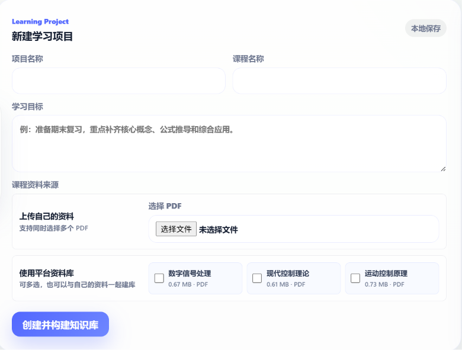
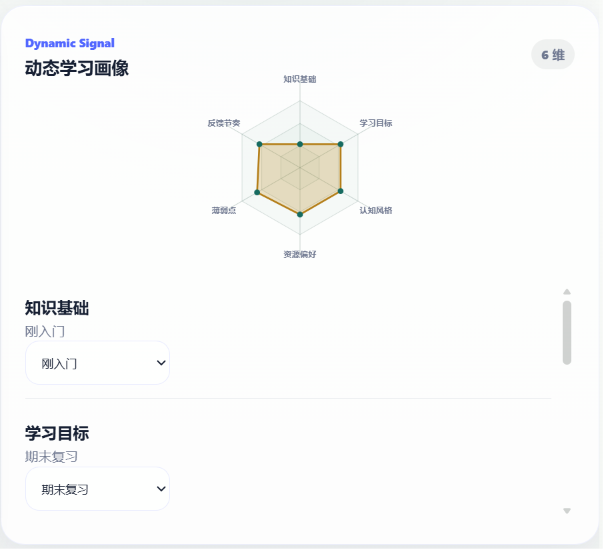
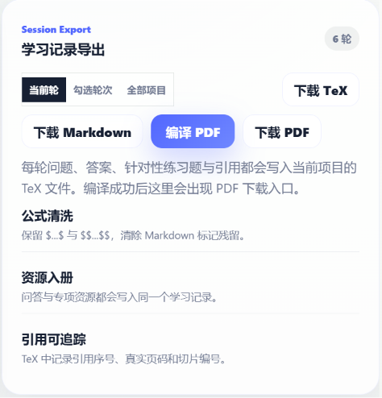
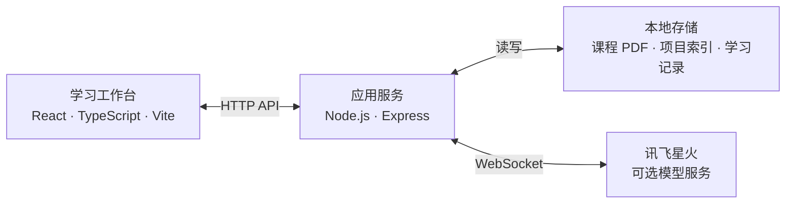

<p align="center">
  
</p>
<h1 align="center">OmniLearn | MAS</h1>
<p align="center"><strong>全域学习多智能体系统</strong></p>
<p align="center">用自己的课程资料建立知识库，带着原文证据学习，并把问答整理成可导出的学习记录。</p>
<p align="center">
  <a href="#项目预览">项目预览</a> ·
  <a href="#快速开始">快速开始</a> ·
  <a href="#技术架构">技术架构</a> ·
  <a href="#环境配置">环境配置</a>
</p>

## 项目预览

| 课程知识库 | 动态学习画像 | 学习记录导出 |
| :---: | :---: | :---: |
|  |  |  |

OmniLearn 面向高校课程自学与复习。每门课可以建立独立的学习项目。工作台会根据学习目标和问答更新学习画像，并展示问题解析、证据检索和资源生成等协作环节。

- **课程资料与证据检索** · 上传 PDF 建立本地索引，问答时可回看引用的原文页码。
- **学习路径与练习** · 根据当前课程、目标与薄弱点生成学习路径、课程讲解和练习。
- **会话整理与导出** · 按当前轮次、勾选轮次或整个项目导出 Markdown、TeX 或 PDF。

## 快速开始

需要 **Node.js 22.19 或更新版本**。在仓库根目录安装锁定版本的依赖。

```sh
npm ci
```

复制环境变量模板。模型凭据默认留空，可以直接体验本地检索和问答。

| 平台 | 命令 |
| --- | --- |
| Windows PowerShell | `Copy-Item -LiteralPath .env.example -Destination .env` |
| Linux / macOS | `cp .env.example .env` |

构建并启动网站。

```sh
npm run build
npm start
```

打开 [本地工作台](http://127.0.0.1:8789)，注册本地账号，上传一份可复制文字的 PDF，然后围绕资料内容提问。

开发时，在两个终端中分别运行 `npm run server` 和 `npm run dev`，打开 Vite 终端显示的地址。开发前端默认使用 `http://127.0.0.1:8789` 作为 API 地址。

## 技术架构



前端渲染 Markdown、KaTeX 公式与 Mermaid 图表。后端管理账号和项目，处理 PDF 解析、按页检索、问答和导出。未配置星火时，后端使用本地检索结果和模板生成回答。

| 路径 | 用途 |
| --- | --- |
| `src/main.tsx`、`src/styles.css` | 登录与学习工作台、用户交互、资源展示和界面样式 |
| `server/index.js` | API、文件存储、PDF 解析、知识检索、星火模型和导出 |
| `public/` | 网站标识与学习画像头像 |
| `docs/images/` | README 中的项目界面截图 |
| `package.json`、`package-lock.json` | npm 脚本、依赖声明与锁定版本 |
| `.env.example` | 本地运行配置模板 |

## 环境配置

从仓库根目录运行时，启动脚本会读取本地 `.env`。服务默认仅监听本机回环地址。

| 变量 | 用途 |
| --- | --- |
| `NODE_ENV` | 模板默认为 `production`，服务端使用环境变量配置模型 |
| `HOST`、`PORT` | 服务监听地址和端口，默认 `127.0.0.1:8789` |
| `DATA_ROOT` | 账号、项目资料、索引和会话的运行目录，默认 `./runtime-data` |
| `PLATFORM_LIBRARY_ROOT` | 可选的平台 PDF 目录，默认 `./platform-library`。初始资料库为空，可自行放入可使用的 PDF |
| `SPARK_APP_ID`、`SPARK_API_KEY`、`SPARK_API_SECRET` | 可选的服务端星火凭据。启用时将三项填入本地 `.env` 并重启服务 |
| `ADMIN_EMAIL` | 可选的本地管理员邮箱。先配置邮箱，再用该邮箱注册，可管理会员兑换码与模型使用额度 |
| `XELATEX_PATH`、`MMDC_PATH`、`CHROMIUM_PATH` | 可选的导出工具可执行文件路径 |

启动在线问答后，学习账号需要在账号设置中兑换管理员创建的会员码，才能使用模型额度。请将真实凭据留在本地 `.env` 或服务器环境中。前端变量 `VITE_API_BASE` 只填写公开的 API 地址。开发时如修改后端端口，可用它指定新的地址。

### 可选系统依赖

- 上传扫描版 PDF 并提取文字需要 Poppler 的 `pdftoppm` 和 Tesseract，OCR 使用 `chi_sim` 与 `eng` 语言数据。
- 编译 PDF 需要 XeLaTeX 和 `ctex` 等 TeX 宏包。PDF 内的 Mermaid 图表转为图片时需要 Mermaid CLI（`mmdc`）和兼容的 Chromium。Markdown 与 TeX 源文件可直接下载。

## 团队

OmniLearn 团队 · 全域学习多智能体系统
